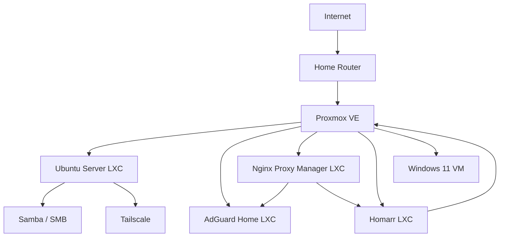
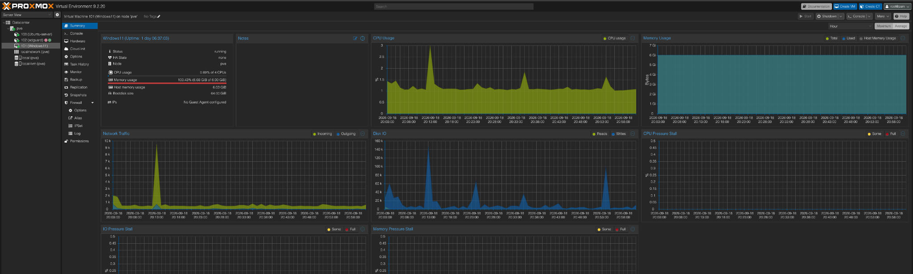
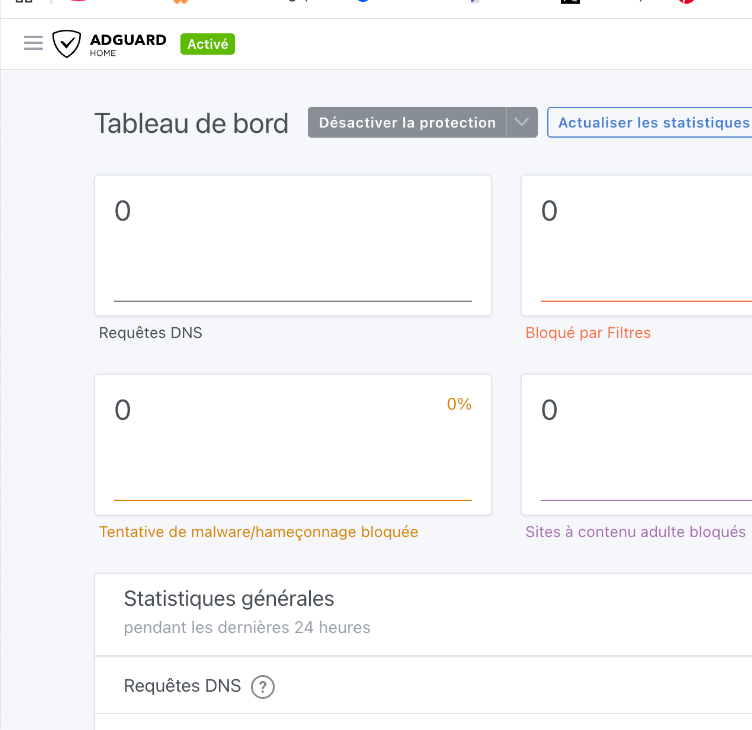
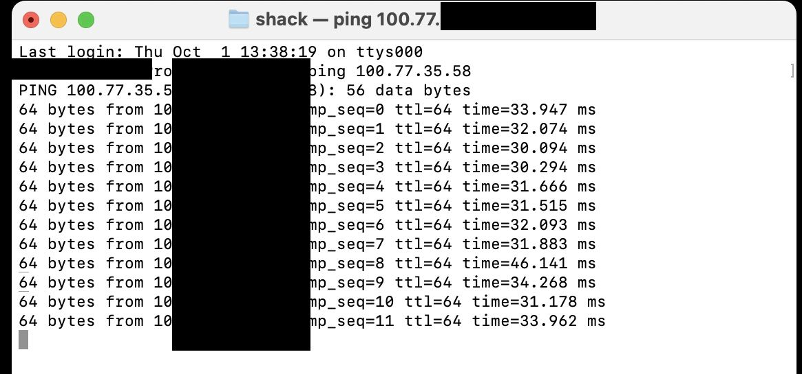
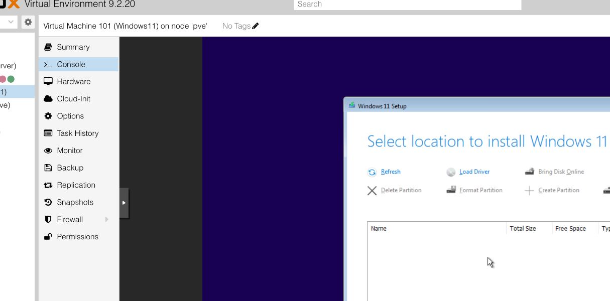
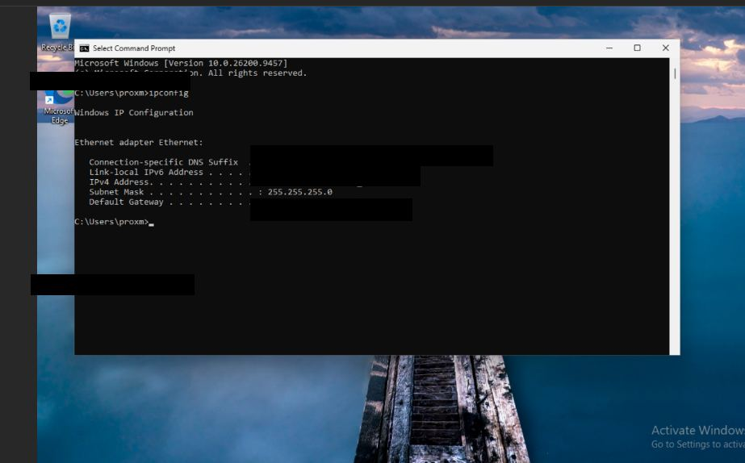

# Proxmox Homelab

## 🇫🇷 Français

Projet de homelab personnel monté pour pratiquer la virtualisation, l’administration Linux, le networking, le self-hosting, l’accès à distance et des bases de cybersécurité.

> **Note pour le repo public :** les IP, credentials, API tokens, certificats et autres informations sensibles sont volontairement cachés ou remplacés par des exemples.

## D’un vieux PC à un vrai homelab

Le projet est parti d’un vieux desktop que j’ai décidé de recycler en serveur Proxmox. Avant même de commencer à jouer avec les LXC, Docker ou les reverse proxies, il a fallu régler la partie physique : réseau, BIOS, stockage, accès Ethernet, etc.

[Voir toute l’histoire de la partie physique](docs/00-physical-build.md)

## Ce qui roule présentement

- **Proxmox VE** — hypervisor principal et gestion du serveur
- **Ubuntu Server LXC** — file server et services Linux
- **Samba** — partage de fichiers en SMB
- **Tailscale** — accès privé à distance
- **AdGuard Home** — DNS filtering
- **Nginx Proxy Manager** — reverse proxy
- **Homarr** — dashboard du homelab
- **Windows 11 VM** — environnement Windows pour les labs

## Architecture

## Compétences travaillées

- administration de Proxmox VE
- LXC containers et virtual machines
- networking Linux et troubleshooting
- partage de fichiers avec SMB/Samba
- DNS et network filtering
- Docker et Docker Compose
- reverse proxies
- accès privé à distance avec Tailscale
- API tokens et permissions en least privilege
- confiance TLS / certificats
- hardening de base et gestion des secrets
- diagnostic avec logs, routes, interfaces et status de services

## Documentation

- [Montage physique et début du projet](docs/00-physical-build.md)
- [Architecture](docs/01-architecture.md)
- [Setup Proxmox](docs/02-proxmox.md)
- [Ubuntu file server](docs/03-ubuntu-samba.md)
- [Accès à distance avec Tailscale](docs/04-tailscale.md)
- [AdGuard Home](docs/05-adguard-home.md)
- [Nginx Proxy Manager](docs/06-nginx-proxy-manager.md)
- [Homarr](docs/07-homarr.md)
- [Windows 11 VM](docs/08-windows-vm.md)
- [Notes de troubleshooting](docs/09-troubleshooting.md)
- [Journal du projet](JOURNAL.md)

## Approche sécurité

Je ne mets jamais de vrais passwords, private keys, API secrets, Tailscale addresses ou authentication tokens dans le repo. Les exemples utilisent seulement des valeurs fictives ou des placeholders.

## Screenshots

Les screenshots ci-dessous ont été nettoyés pour être publiés. Les credentials, API tokens, identifiants, certificats, adresses d’accès à distance et autres informations sensibles sont cachés ou recadrés.

### Proxmox VE

Interface principale de Proxmox utilisée pour surveiller le host, les containers, les VMs, le storage et l’utilisation des ressources.

### AdGuard Home

Dashboard utilisé pour vérifier que les requêtes DNS passent réellement par AdGuard Home.

### Nginx Proxy Manager

Dashboard utilisé pour centraliser l’accès aux services web internes avec un reverse proxy.

### Configuration d’un Proxy Host

Exemple d’un Proxy Host avec l’adresse du backend cachée volontairement.

### Troubleshooting Homarr ↔ Proxmox

À ce moment-là, la partie TLS fonctionnait, mais le Proxmox API token n’avait pas encore les bonnes permissions.

### Accès distant avec Tailscale

Test fait à partir d’un autre réseau pour confirmer que le tunnel Tailscale fonctionnait. L’adresse Tailscale et l’identité du shell sont cachées.

### Setup du driver VirtIO sur Windows 11

Windows Setup ne voyait pas le virtual disk avant que le bon VirtIO SCSI driver soit chargé.

### Windows 11 VM en fonction

Windows 11 roule dans Proxmox avec les informations réseau et utilisateur masquées.

## Prochaines étapes

- ajouter Uptime Kuma pour le monitoring
- déployer Immich pour les photos
- ajouter un stack de monitoring cybersécurité
- améliorer les noms DNS locaux
- documenter les backups et la recovery

---

## 🇬🇧 English

# Proxmox Homelab

A personal homelab built to practice virtualization, Linux administration, networking, self-hosting, remote access, and cybersecurity fundamentals.

> **Public-repo note:** IP addresses, credentials, API tokens, certificates, and other sensitive values are intentionally omitted or replaced with examples.

## From old desktop to homelab

This project started by repurposing an older desktop tower into a dedicated Proxmox server. Before the software stack existed, the build involved solving physical-network constraints, enabling hardware virtualization in BIOS, integrating external storage, and working around the lack of a direct Ethernet run.

[Read the physical build story](docs/00-physical-build.md)

## What is running

- **Proxmox VE** — hypervisor and central management
- **Ubuntu Server LXC** — file services and Linux administration
- **Samba** — SMB file sharing
- **Tailscale** — private remote access to the homelab
- **AdGuard Home** — network-level DNS filtering
- **Nginx Proxy Manager** — reverse proxy management
- **Homarr** — homelab dashboard
- **Windows 11 VM** — Windows lab environment

## Architecture

## Skills practiced

- Proxmox VE administration
- LXC containers and virtual machines
- Linux networking and troubleshooting
- SMB/Samba file sharing
- DNS and network filtering
- Docker and Docker Compose
- Reverse proxies
- VPN-style private networking with Tailscale
- API tokens and least-privilege permissions
- TLS certificate trust
- Basic service hardening and secret-management practices
- Troubleshooting from logs, routes, interfaces, and service status

## Documentation

- [Physical build & early setup](docs/00-physical-build.md)
- [Architecture](docs/01-architecture.md)
- [Proxmox setup](docs/02-proxmox.md)
- [Ubuntu file server](docs/03-ubuntu-samba.md)
- [Remote access with Tailscale](docs/04-tailscale.md)
- [AdGuard Home](docs/05-adguard-home.md)
- [Nginx Proxy Manager](docs/06-nginx-proxy-manager.md)
- [Homarr](docs/07-homarr.md)
- [Windows 11 VM](docs/08-windows-vm.md)
- [Troubleshooting notes](docs/09-troubleshooting.md)
- [Project journal](JOURNAL.md)

## Security approach

This repository never stores real passwords, private keys, API secrets, Tailscale addresses, or authentication tokens. Configuration examples use placeholders only.

## Screenshots

The screenshots below are sanitized for public sharing. Credentials, API tokens, account identifiers, certificates, remote-access addresses, and other sensitive values are hidden or cropped.

### Proxmox VE

Central Proxmox management interface used to monitor the host, containers, virtual machines, storage, and resource usage.

### AdGuard Home

DNS filtering dashboard used to verify that client DNS requests are actually flowing through AdGuard Home.

### Nginx Proxy Manager

Reverse-proxy dashboard used to centralize access to internal web services.

### Proxy host configuration

A sanitized example of a proxy host. The backend address is intentionally hidden.

### Homarr ↔ Proxmox integration troubleshooting

This captures the stage where TLS trust was working but the Proxmox API token still lacked sufficient authorization.

### Tailscale remote access

Remote connectivity test from outside the home network. The Tailscale address and local shell identity are hidden.

### Windows 11 VirtIO driver setup

Windows Setup required the VirtIO SCSI driver before the virtual disk became visible.

### Windows 11 VM running

Windows 11 running inside Proxmox. User and network-identifying values are hidden.

## Next steps

- Add Uptime Kuma for service monitoring
- Deploy Immich for photo management
- Add a dedicated cybersecurity monitoring stack
- Improve local DNS names for internal services
- Add backups and recovery documentation
