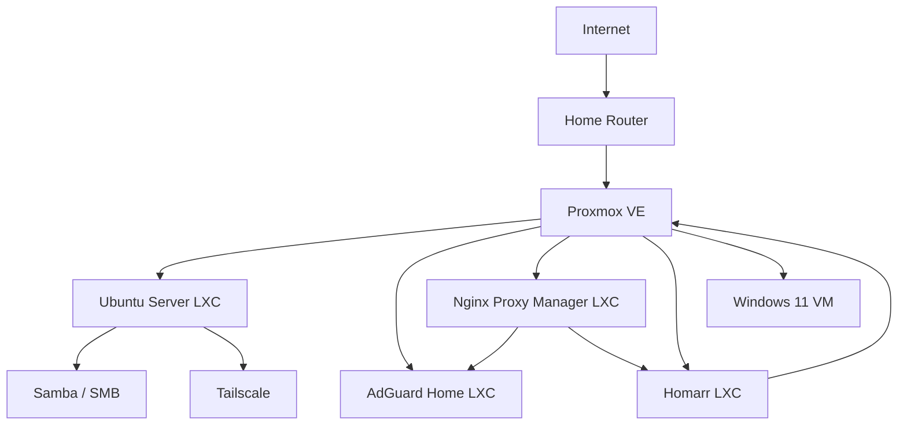

# Proxmox Homelab

A personal homelab built to practice virtualization, Linux administration, networking, self-hosting, remote access, and cybersecurity fundamentals.

> **Public-repo note:** IP addresses, credentials, API tokens, certificates, and other sensitive values are intentionally omitted or replaced with examples.

## What is running

- **Proxmox VE** — hypervisor and central management
- **Ubuntu Server LXC** — file services and Linux administration
- **Samba** — SMB file sharing
- **Tailscale** — private remote access to the homelab
- **AdGuard Home** — network-level DNS filtering
- **Nginx Proxy Manager** — reverse proxy management
- **Homarr** — homelab dashboard
- **Windows 11 VM** — Windows lab environment

## Architecture

## Skills practiced

- Proxmox VE administration
- LXC containers and virtual machines
- Linux networking and troubleshooting
- SMB/Samba file sharing
- DNS and network filtering
- Docker and Docker Compose
- Reverse proxies
- VPN-style private networking with Tailscale
- API tokens and least-privilege permissions
- TLS certificate trust
- Basic service hardening and secret-management practices
- Troubleshooting from logs, routes, interfaces, and service status

## Documentation

- [Architecture](docs/01-architecture.md)
- [Proxmox setup](docs/02-proxmox.md)
- [Ubuntu file server](docs/03-ubuntu-samba.md)
- [Remote access with Tailscale](docs/04-tailscale.md)
- [AdGuard Home](docs/05-adguard-home.md)
- [Nginx Proxy Manager](docs/06-nginx-proxy-manager.md)
- [Homarr](docs/07-homarr.md)
- [Windows 11 VM](docs/08-windows-vm.md)
- [Troubleshooting notes](docs/09-troubleshooting.md)
- [Project journal](JOURNAL.md)

## Security approach

This repository never stores real passwords, private keys, API secrets, Tailscale addresses, or authentication tokens. Configuration examples use placeholders only.

## Screenshots

The screenshots below are sanitized for public sharing. Credentials, API tokens, account identifiers, certificates, remote-access addresses, and other sensitive values are hidden or cropped.

### Proxmox VE

Central Proxmox management interface used to monitor the host, containers, virtual machines, storage, and resource usage.

### AdGuard Home

DNS filtering dashboard used to verify that client DNS requests are actually flowing through AdGuard Home.

### Nginx Proxy Manager

Reverse-proxy dashboard used to centralize access to internal web services.

### Proxy host configuration

A sanitized example of a proxy host. The backend address is intentionally hidden.

### Homarr ↔ Proxmox integration troubleshooting

This captures the stage where TLS trust was working but the Proxmox API token still lacked sufficient authorization.

### Tailscale remote access

Remote connectivity test from outside the home network. The Tailscale address and local shell identity are hidden.

### Windows 11 VirtIO driver setup

Windows Setup required the VirtIO SCSI driver before the virtual disk became visible.

### Windows 11 VM running

Windows 11 running inside Proxmox. User and network-identifying values are hidden.

## Next steps

- Add Uptime Kuma for service monitoring
- Deploy Immich for photo management
- Add a dedicated cybersecurity monitoring stack
- Improve local DNS names for internal services
- Add backups and recovery documentation
