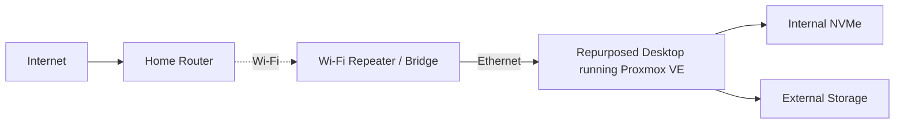

# Physical Build & Early Setup

Before any containers, reverse proxies, dashboards, or remote-access tooling worked, the project started with a much less glamorous problem: turning an old desktop into an actual usable homelab server.

## Starting point

The server was built from an older desktop tower that was repurposed instead of buying dedicated server hardware.

The main goals were:

- reuse existing hardware;
- install Proxmox VE as the hypervisor;
- host Linux services and Windows lab VMs;
- add shared storage;
- make the server accessible without running a new Ethernet cable through the house.

## Problems encountered

### 1. No convenient Ethernet connection near the server

**Problem:** The tower was installed in a room without a direct Ethernet run to the router.

**Why it mattered:** A hypervisor is much easier to manage when it has a stable wired connection. Wi-Fi support on Proxmox is also less straightforward than on a normal desktop operating system.

**Approach considered:**

- USB/PCIe Wi-Fi adapter;
- Wi-Fi repeater with Ethernet output;
- powerline adapters;
- eventually, a proper wired or mesh backhaul.

**Temporary solution:** Used a Wi-Fi repeater / wireless bridge arrangement to give the server Ethernet connectivity.

**Lesson learned:** The physical network is part of the server design. A perfectly configured Proxmox host is still frustrating if the uplink is unstable or slow.

### 2. Initial Proxmox network address was unreachable

**Symptom:** After installation, the Proxmox web interface could not reliably be reached from another computer.

**What was checked:**

- router gateway;
- subnet;
- chosen static IP;
- bridge configuration;
- whether the selected NIC actually had connectivity.

**Fix:** Corrected the network configuration and verified access to the Proxmox web interface from the LAN.

**Lesson learned:** A static IP is useful for infrastructure, but it must match the real LAN and gateway.

### 3. Hardware virtualization was disabled in BIOS

**Symptom:** Proxmox reported that hardware-accelerated KVM was unavailable.

**Cause:** Intel VMX / VT-x was disabled in firmware.

**Fix:** Entered the BIOS, enabled Intel VMX, saved the settings, and rebooted.

**Result:** Full virtualization support became available for VMs.

### 4. Repurposed storage needed to be integrated

The build used the internal NVMe drive for Proxmox/VM storage and an external drive for file storage.

An external exFAT drive was mounted on the Proxmox host and then passed into the Ubuntu Server LXC.

**Problem:** exFAT does not behave like a normal Linux filesystem for ownership and permissions.

**Fix:** Used mount options with the correct UID/GID mapping so the unprivileged LXC user could read and write files.

### 5. Performance depended on more than CPU and RAM

At one point, file/photo browsing felt slower than expected.

The likely bottleneck was not only the VM/container configuration but also the physical network path:

```text
Client
  -> Wi-Fi
Router
  -> Wi-Fi
Repeater / bridge
  -> Ethernet
Proxmox server
```

Every extra wireless hop can reduce throughput and increase latency.

**Lesson learned:** Homelab performance is a combination of compute, storage, and networking. Adding RAM does not fix a weak wireless uplink.

## Final physical layout



## Why this part matters

This phase ended up being one of the most useful parts of the project because it involved real infrastructure constraints:

- hardware reuse;
- BIOS configuration;
- physical networking;
- storage mounting;
- Linux permissions;
- diagnosing whether a problem was hardware, network, or software.

The homelab was not just "installed from a tutorial" — it had to be adapted to the physical environment it was actually running in.
