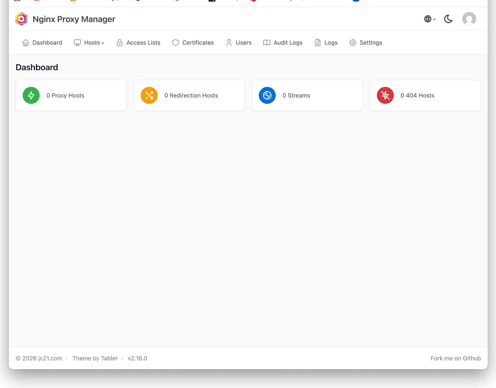
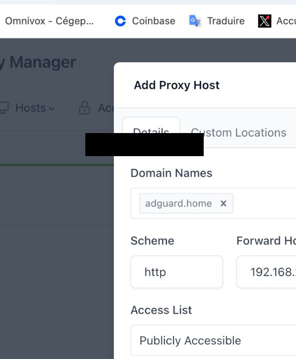

# Nginx Proxy Manager

## 🇨🇦 Français (Québec)

Nginx Proxy Manager donne une interface graphique pour gérer les reverse proxies.

## Problèmes rencontrés

### 1. Le LXC n’avait pas de connectivité IPv4

**Symptômes :**

```text
Temporary failure resolving 'archive.ubuntu.com'
ping: connect: Network is unreachable
```

**Diagnostic :** `ip -br addr` montrait seulement une IPv6 link-local address (`fe80::...`) et aucune IPv4 utilisable.

**Ce que ça voulait dire :** l’interface du container existait, mais elle n’avait pas reçu de vraie IPv4 ni de default route.

**Fix :** dans Proxmox, modification de `net0`, activation de IPv4 DHCP sur `vmbr0`, puis restart du container.

**Ce que j’ai retenu :** une erreur qui ressemble à du DNS peut en réalité être un problème réseau plus bas niveau. Toujours tester une IP brute avant de blâmer le DNS.

### 2. Les packages Docker ne se téléchargeaient pas

**Symptôme :** `apt` ne trouvait pas ou ne téléchargeait pas les packages Docker.

**Ce que ça voulait dire :** le vrai problème était encore la connectivité réseau du LXC.

**Fix :** réparer le networking d’abord, refaire `apt update`, puis installer Docker et Docker Compose.

### 3. Un hostname propre ne fonctionne pas juste parce qu’il existe dans Nginx Proxy Manager

**Symptôme :** créer un Proxy Host comme `adguard.home` ne rendait pas automatiquement ce nom accessible.

**Ce que ça voulait dire :** Nginx Proxy Manager gère le routing HTTP après que le hostname arrive jusqu’à lui. Le DNS doit quand même savoir où envoyer ce hostname.

**Fix :** hosts-file pour les premiers tests, puis planification de local DNS records.

```text
service.example.internal
        -> DNS resolves to Nginx Proxy Manager
        -> Nginx Proxy Manager
        -> backend-service:port
```

## Résultat



L’interface confirme que Nginx Proxy Manager roule correctement.

## Exemple de Proxy Host



La capture montre la structure de la configuration sans exposer la vraie backend IP.

---

## 🇬🇧 English

# Nginx Proxy Manager

Nginx Proxy Manager provides a graphical interface for reverse-proxy configuration.

## Problems encountered

### 1. The LXC had no IPv4 connectivity

**Symptoms:**

```text
Temporary failure resolving 'archive.ubuntu.com'
ping: connect: Network is unreachable
```

**Diagnosis:** `ip -br addr` showed only an IPv6 link-local address (`fe80::...`) and no `192.168.x.x` IPv4 address.

**What it meant:** The container interface existed, but it had not received a usable IPv4 configuration or default route.

**Fix:** In Proxmox, edited `net0` and enabled IPv4 DHCP on bridge `vmbr0`, then restarted the container.

**Lesson learned:** A DNS error can actually be a lower-level network problem. Always test raw connectivity first.

### 2. Docker packages could not be downloaded

**Symptom:** `apt` could not locate or download Docker-related packages.

**What it meant:** This was a consequence of the missing network connectivity, not necessarily a Docker problem.

**Fix:** Repaired the LXC network first, reran `apt update`, then installed Docker and Docker Compose.

### 3. Friendly hostnames do not work automatically

**Symptom:** Creating a proxy host such as `adguard.home` did not automatically make the name resolvable.

**What it meant:** Nginx Proxy Manager routes HTTP requests after a hostname reaches it; DNS still has to map that hostname to the NPM server.

**Fix:** Used a hosts-file entry for testing and planned local DNS records for a cleaner long-term setup.

Example concept:

```text
service.example.internal
        -> DNS resolves to Nginx Proxy Manager
        -> Nginx Proxy Manager
        -> backend-service:port
```

## Result


The management interface confirms that the service is running and ready to manage proxy hosts.

## Proxy host example


This public-safe screenshot shows the structure of a proxy host configuration while hiding the real backend IP address.
