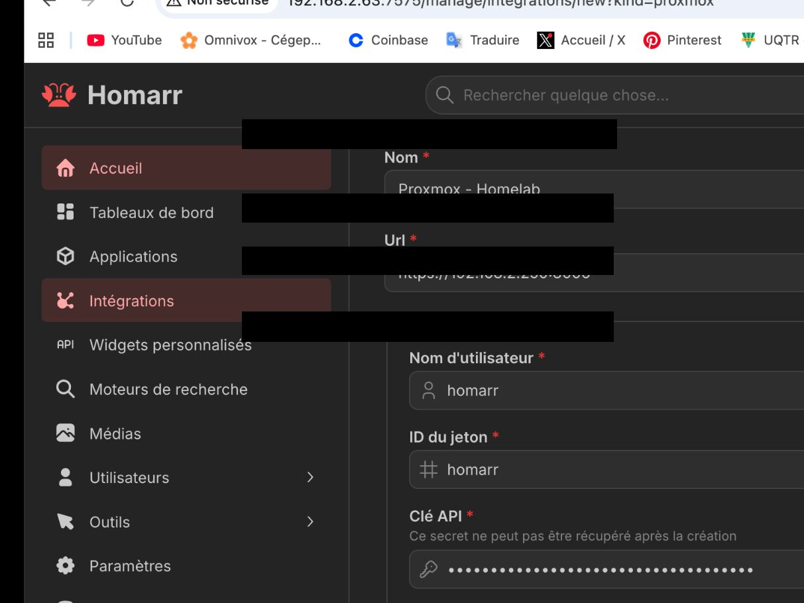

# Homarr

Homarr provides a centralized dashboard for homelab services.

## Problems encountered

### 1. The Homarr LXC temporarily had multiple IPv4 addresses

**Symptom:** `ip -br addr` showed more than one IPv4 address on the same interface.

**What it meant:** The container had overlapping/dynamic addressing information, which can make it unclear which address should be used.

**Approach:** Used the working address for initial setup and identified IP cleanup/static reservation as a later networking improvement.

### 2. Proxmox integration failed because the TLS certificate was not trusted

**Symptom:** Homarr reported a certificate error such as `UNABLE_TO_VERIFY_LEAF_SIGNATURE`.

**What it meant:** Proxmox uses a certificate issued by its own internal CA. Homarr did not trust that CA automatically.

**Fix:** Exported the Proxmox root CA certificate and imported/trusted it in Homarr.

**Lesson learned:** Do not disable TLS verification just to make an integration work. Trust the correct CA instead.

### 3. Proxmox integration then failed with an authorization error

**Symptom:** After fixing TLS, Homarr could reach Proxmox but returned an authorization error.

**What it meant:** Connectivity and certificate trust were now correct, but the API account/token did not have the required permissions.

**Fix:** Created a dedicated Proxmox API user/token and granted read-only `PVEAuditor` permissions.

**Lesson learned:** Authentication and authorization are separate. A valid token can still fail if it lacks permission to read the requested resources.

## Authorization troubleshooting

At this point, certificate trust was already fixed. The remaining error therefore narrowed the problem down to API authorization. The Proxmox URL, user, token ID, and API secret are blacked out in the public screenshot.
